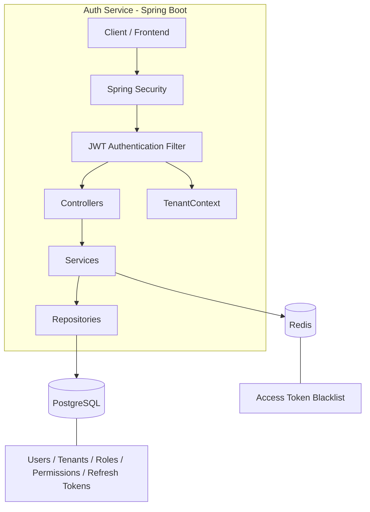
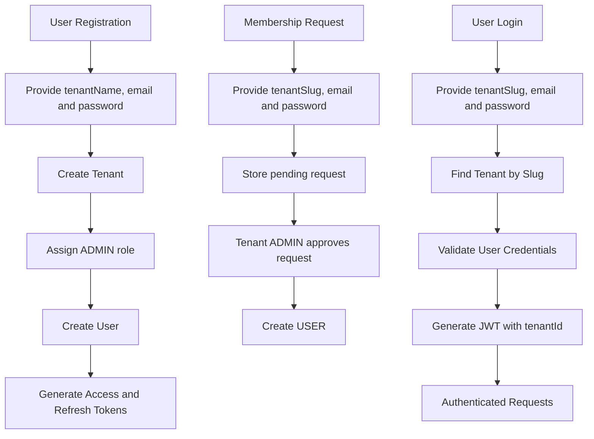
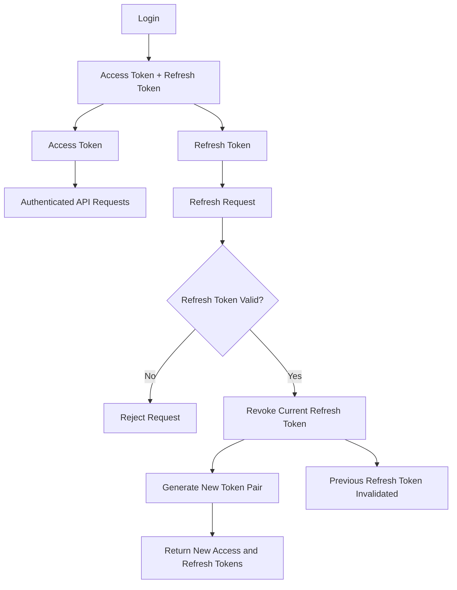

# 🔐 Auth Service

Authentication and Authorization Service built with **Spring Boot**, designed for secure and scalable SaaS applications.

Implements JWT authentication, Role-Based Access Control (RBAC), refresh token rotation with reuse detection, and multi-tenant architecture.

---

## ⭐ Highlights

- Multi-tenant architecture (SaaS-ready)
- Tenant-based authentication using a unique tenant slug
- Refresh token rotation with reuse detection
- Redis-based access token blacklist
- Redis-backed rate limiting for public authentication endpoints
- Tenant-scoped authentication and membership approval
- Interactive OpenAPI documentation with Swagger UI

---

## 🚀 Tech Stack

- Java 21
- Spring Boot
- Spring Security
- JWT (JJWT)
- PostgreSQL
- Redis
- Flyway (database migrations)
- Docker & Docker Compose
- JUnit 5
- Testcontainers

---

## 📌 Features

- ✅ User registration
- ✅ JWT authentication
- ✅ Refresh token rotation and reuse detection
- ✅ Role-Based Access Control (RBAC)
- ✅ Permission management
- ✅ Logout with token revocation and Redis blacklist
- ✅ Protected endpoints
- ✅ Database versioning with Flyway
- ✅ Multi-tenant architecture
- ✅ Tenant-scoped email uniqueness
- ✅ Support for different email domains within the same tenant
- ✅ Tenant identification using a unique slug
- ✅ Membership requests approved by a tenant administrator
- ✅ Redis-backed rate limiting for authentication endpoints
- ✅ OpenAPI documentation with Swagger UI
- ✅ Integration tests with PostgreSQL and Redis using Testcontainers

---

## 🏗️ Architecture

The project follows a layered architecture, separating HTTP handling, business logic, data access, and security responsibilities.

### System Architecture



### Application Layers

- **Controller** → handles HTTP requests
- **Service** → implements business logic
- **Repository** → manages data access
- **Security** → JWT, filters, and authentication logic
- **DTO** → request and response models
- **Config** → application configuration
- **Entity** → JPA domain entities

---

## 🧩 Multi-Tenant Design

This project implements a shared database and shared schema architecture.

```text
Shared Database + Shared Schema + tenant_id
```

### Key Concepts

- Each user belongs to a **tenant**.
- Each tenant has a unique **slug** used during authentication.
- Users are identified by their email within their tenant.
- The same email address can exist in different tenants.
- Users within the same tenant can have different email domains.
- `tenant_id` is included in the JWT claims.
- `TenantContext` (ThreadLocal) propagates the current tenant context during request processing.
- Tenant isolation is enforced through tenant-aware authentication and data access.

### Example

```text
Tenant: Acme
Slug: acme

admin@acme.com  → Tenant: Acme (ADMIN)
user@gmail.com  → Tenant: Acme (USER)
```

Both users belong to the same tenant, even though their email domains are different.

---

## 🔐 Authentication Flow

The authentication process supports automatic tenant creation and tenant-based login.

### Registration, Membership and Login



### Authentication Rules

1. Registration creates a new tenant and its initial **ADMIN** user.
2. Registering a tenant name that already exists is rejected.
3. To join an existing tenant, a person submits a membership request with its slug.
4. An **ADMIN** of that tenant approves the request, creating the **USER** account.
5. The tenant is identified during login using its unique slug.
6. JWT tokens include the user's `tenantId`.
7. Authenticated requests use the JWT to establish the tenant context and validate access.

---

## 🔄 Token Flow

The service uses short-lived access tokens and refresh tokens to maintain authenticated sessions.

### Token Lifecycle



Refresh token reuse detection prevents previously rotated tokens from being reused.

---

## 🔒 Security

- Passwords hashed with BCrypt.
- JWT signed with a secret key.
- Token expiration enforced.
- Refresh token rotation with reuse detection.
- Refresh tokens stored as SHA-256 hashes.
- Role- and permission-based authorization.
- Access token blacklist using Redis.
- Rate limiting by client address: login (5/min), refresh (10/min), registration and membership requests (3/hour).
- Stateless HTTP security configuration.
- Tenant-aware authentication and isolation.

---

## ⚙️ Running the Project

### Requirements

- Java 21
- Docker
- Docker Compose

### Run with Docker

Create the local environment file and generate a JWT signing secret:

```bash
cp .env.example .env
openssl rand -base64 32
```

Set the generated value in `JWT_SECRET` in `.env`, then start the stack:

```bash
docker compose up --build -d
docker compose logs -f auth-service
```

The API is available at:

```text
http://localhost:8080
```

Interactive API documentation is available at:

```text
http://localhost:8080/swagger-ui/index.html
```

The OpenAPI specification is exposed at `/v3/api-docs`.

Docker Compose exposes only the API port. PostgreSQL and Redis communicate with
the application through the internal service names `db` and `redis`; access the
database for diagnostics with `docker compose exec db psql -U auth -d authdb`.

---

## 🔑 Environment Variables

Create a `.env` file in the project root.

```env
SPRING_PROFILES_ACTIVE=prod

DB_NAME=authdb
DB_URL=jdbc:postgresql://db:5432/authdb
DB_USER=auth
DB_PASSWORD=auth

REDIS_HOST=redis
REDIS_PORT=6379

JWT_SECRET=<output of openssl rand -base64 32>
JWT_EXPIRATION=900000
```

`DB_URL`, `REDIS_HOST` and `REDIS_PORT` use Docker Compose internal networking.
For a local process started outside Docker, use `localhost` instead. The
application runs Flyway automatically at startup after PostgreSQL becomes healthy.

---

## 🧩 Application Profiles

The application supports multiple profiles:

- `dev` → local development
- `prod` → production environment

Set the active profile using:

```env
SPRING_PROFILES_ACTIVE=prod
```

---

## 📡 API Endpoints

### 🔐 Authentication

#### Register

```http
POST /auth/register
```

Creates a new tenant and its initial administrator. A request using an existing
tenant name is rejected; use the membership-request flow to join that tenant.

Example:

```json
{
  "email": "admin@empresa.com",
  "password": "Password123",
  "tenantName": "Empresa A"
}
```

#### Login

```http
POST /auth/login
```

Authentication requires the tenant slug, email, and password.

Example:

```json
{
  "tenantSlug": "empresa-a",
  "email": "admin@empresa.com",
  "password": "Password123"
}
```

#### Refresh Token

```http
POST /auth/refresh
```

Example:

```json
{
  "refreshToken": "<refresh_token>"
}
```

#### Logout

```http
POST /auth/logout
Authorization: Bearer <access_token>
Content-Type: application/json
```

Example:

```json
{
  "refreshToken": "<refresh_token>"
}
```

Returns `204 No Content` when logout succeeds.

#### Request Membership

```http
POST /auth/membership-requests
```

Creates a pending request to join an existing tenant and returns `202 Accepted`.

```json
{
  "tenantSlug": "empresa-a",
  "email": "user@example.com",
  "password": "Password123"
}
```

#### Manage Membership Requests

Both endpoints require an access token belonging to an **ADMIN** of the current
tenant.

```http
GET /tenants/membership-requests
Authorization: Bearer <access_token>
```

```http
POST /tenants/membership-requests/{requestId}/approve
Authorization: Bearer <access_token>
```

Approving a request creates the `USER` account and returns `204 No Content`.

---

## 🔒 Protected Routes

Example:

```http
GET /api/admin
Authorization: Bearer <access_token>
```

The service also provides role-protected routes, such as `/api/user`.

---

## 🗄️ Database

Database schema and versioning are managed using Flyway migrations.

Current migrations:

- `V1__init_schema.sql`
- `V2__seed_roles_permissions.sql`
- `V3__add_multi_tenant.sql`
- `V4__associate_roles_permissions.sql`
- `V5__hash_refresh_tokens.sql`
- `V6__composite_unique_user_email_tenant.sql`
- `V7__add_membership_requests.sql`

---

## 🧪 Testing

The project includes automated unit and integration tests.

**Testing stack:**

- JUnit 5
- Spring Boot Test
- MockMvc
- Testcontainers
- PostgreSQL
- Redis

Integration tests validate:

- Authentication and authorization.
- Role-based access control.
- Refresh token rotation and reuse detection.
- Logout and token invalidation.
- Tenant isolation.
- Same email address across different tenants.
- Different email domains within the same tenant.
- Membership request and approval flow.
- Rate limiting of public authentication endpoints.
- OpenAPI documentation availability without authentication.
- Stateless HTTP session behavior.

Latest verification:

```text
Tests run: 35
Failures: 0
Errors: 0
Skipped: 0

BUILD SUCCESS
```

Run the test suite using:

```bash
./mvnw clean verify
```

---

## 📁 Project Structure

```text
src/main/java/com/auth/authservice
├── config
├── controller
├── service
├── repository
├── entity
├── security
├── dto
└── exception
```

---

## 📦 Future Improvements

- OAuth2 / OpenID Connect
- API Gateway integration
- Audit logs
- Distributed tracing
- Custom tenant domains

---

## 💡 Notes

This project was designed to simulate a real-world authentication and authorization service, focusing on:

- Security best practices
- Scalable architecture
- Reusable authentication infrastructure
- SaaS multi-tenant design
- Separation of authentication and business services

---

## 👨‍💻 Author

Developed by **Arlindo Fernandes**
